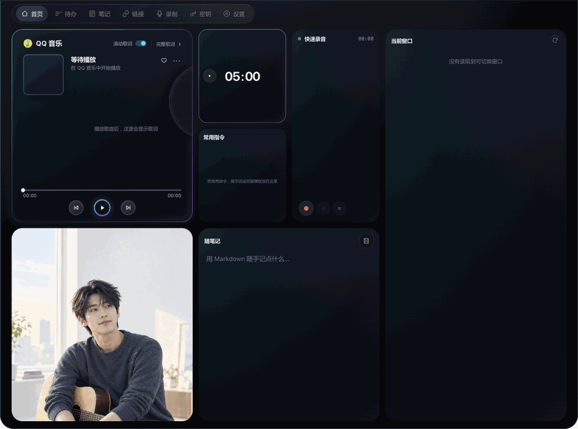

  
  <h1>灵屿 · Lingyu</h1>
  
把待办、笔记和正在播放的音乐，收进屏幕顶部。

灵屿是基于 [TO-DO Panel](https://github.com/xiaopu-ai/TO-DO-Panel) 定制的本地桌面工作台。本仓库为 Freya Qian 的项目展示页，源码不公开。

**当前归档版本：1.2.2**。已在本机 macOS Apple Silicon 使用；Windows 的基础代码沿用原项目，本次 QQ 音乐与外观定制未做 Windows 安装包验收。

## 交互演示

  

实录仓库中的前端界面在浏览器里的交互：开始番茄计时 → 倒计时 → 新增待办 → 标记完成 → 返回首页。使用独立演示数据；QQ 音乐保持“等待播放”，此演示不包含系统音乐联动、摄像头或录音。

## 功能

- **QQ 音乐**：读取当前歌曲与播放状态，控制上一首、播放/暂停、下一首；读取会话提供的真实封面。
- **歌词**：自动匹配，可切换聚焦视图/完整歌词，选择自动滚动/手动浏览；随播放时间逐行推进。
- **待办与计时**：分类待办、搜索、截止日期、重复任务、备注、标签、子步骤和番茄钟。
- **笔记与链接**：Markdown 速记、保存和整理笔记、收藏链接。
- **录音与工作区**：录音、可配置的转写与待办提取，工作区备份和恢复。
- **桌面组件**：按需开启镜子、查看当前窗口，以及本机 AI 任务完成提醒。

外观保留贴顶展开、细青紫渐变边框和唱片装饰；折叠时不显示横线。音乐卡片的边框始终位于唱片上方。首页与其他 Tab 统一深蓝黑底色，普通卡片不加描边，鼠标悬停时显示淡青蓝光晕；照片移除后沿用相同底色。

## 数据与来源

用户数据写入本机 Electron 用户数据目录，不在源码中。为兼容原有数据和系统权限，本版本保留原应用标识与 `Dynamic Panel` 数据目录。

原项目：[xiaopu-ai/TO-DO-Panel](https://github.com/xiaopu-ai/TO-DO-Panel)，基于 v1.2.0 定制。原版权和 [MIT 许可证](LICENSE) 保留。灵屿名称、外观及 QQ 音乐定制由 Freya Qian 整理维护。

[返回项目主页](https://github.com/Freya-Qian#-项目)

## 设计思路

- 定位：桌面工作台

---
本仓库仅用于展示，不含源码。更多作品见 [作品集](https://freya-qian.github.io/)。
